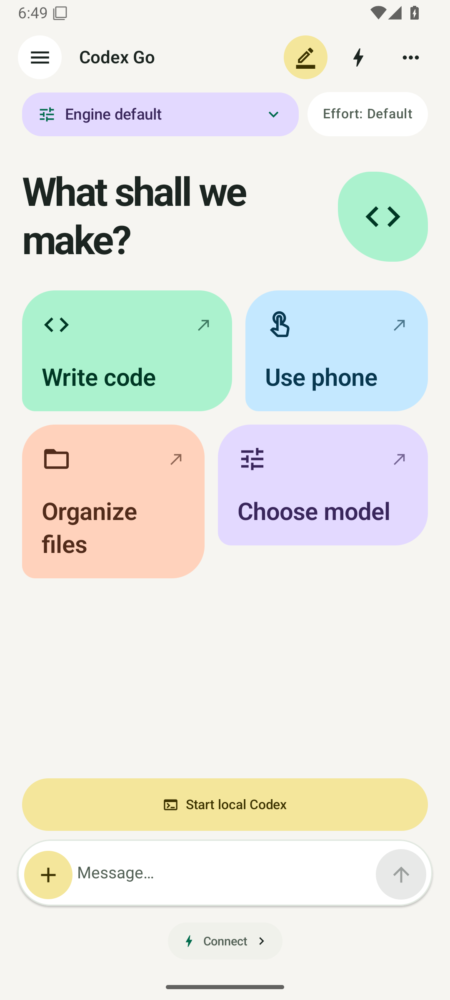
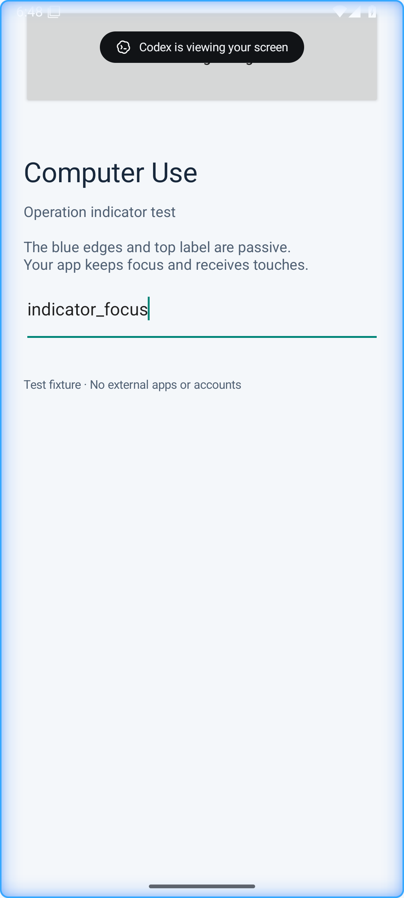

# Codex Go

把 Codex 直接运行在 Android 手机上。全新 Kotlin / Jetpack Compose 项目，使用 Material 3 Expressive + Bento：青绿主题、分块快捷动作、项目网格、常驻模型选择和贴底输入框。

首版专注本机。没有远程主机管理。

[下载 0.23.0 预览版（ARM64 APK）](https://github.com/HyacineFengJin/Codex-Go/releases/download/v0.23.0/codex-go.apk) · [所有 Release](https://github.com/HyacineFengJin/Codex-Go/releases) · [版本说明](docs/release.md)

0.23.0 将 Codex CLI 更新到 0.171.0，模型目录包含 GPT‑6.2 Sol 和 Astra。以后可单独安装 CLI 运行时包。「设置 → 关于」提供 CLI 下载和应用更新检查。

0.21.0 修复跨引擎分享 / 快速消息的草稿恢复、重复合并和文件编辑器旋转丢稿；验证升级安装、退回桌面、进程终止、强制停止及设备重启后继续使用。见 [本轮检查](docs/lifecycle-selfcheck.md) 和 [限制审计](docs/limits.md)。同时发布此前的局部玻璃悬浮窗、[APK 插件系统](docs/plugins.md) 及解除配额后的大内容 / 取消修复。公开 APK 包含 Codex 运行时；[Antigravity 实验适配](docs/antigravity.md) 保留在源码中，未包含 Google CLI。

Android 11 及以上。原创部分使用 [MIT License](LICENSE)，第三方部分保留原许可，见 [NOTICE](NOTICE) 和 [第三方组件](docs/third-party.md)。

<p>
  
  
</p>

## 目前实现

- 简体中文 / English / 跟随系统，设置中随时切换；Android 13 以上接入系统应用语言。用户输入、项目名称和模型内容保持原文。

- 精简的 M3 Expressive + Bento 界面：常驻模型入口、彩色动作卡、短状态和按需展开的设置，适配深浅色、小屏与大字号。
- 聊天页快捷控制，自动准备引擎，恢复已授权连接、记住 Shell 方式与悬浮窗选择。系统授权并连接后 AI 直接可用。

- App 私有 Linux 环境与官方 Codex 0.171.0，ARM64 / x86_64，免 Root / Termux；内置 Python 3、pip、Node.js、npm 和 Git。
- ChatGPT 设备码登录；可用模型从本机 app-server 获取。顶部“模型”按钮可搜索名称 / ID、刷新和选择模型，再调整支持的思考深度。选择保存并实际传入下一次请求，运行中锁定修改。
- 流式对话、停止任务、工具过程折叠、带 diff 的文件审批及提问表单。普通短命令可从通知审批；长命令、文件差异和提问回到 App 查看。
- 执行中插话、排队 / 撤回、中断并发送、失败重试和编辑重发。草稿与队列按会话保存，停止、失败和重启后队列需要显式继续。
- 项目创建 / 改名 / 切换，独立工作目录与新对话草稿；旧工作区保留在默认项目。历史、材料和产物跟随原生项目 cwd，执行归属保持不变，任务运行时可浏览其他项目并准备草稿。
- 后台跨会话浏览：A 的流式任务继续时可查看 B，独立保存 B 的草稿 / 附件与阅读位置；任务栏、通知和审批回到 A，任务结束后显式进入 B 再发送。
- Codex 原生历史会话；优先分页接口，本机服务未提供分页时回退到 `thread/read`。单条 RPC 返回上限提高至 128 Mi 字符，可恢复积累大量截图的对话；列表读取错误可单独重试。
- 可选历史图片压缩：后续模型请求里的旧图使用最长边 768 的 JPEG 预览，最新一次观察保持原样。原图按会话保存，Codex 可用内置的历史图片工具列出 / 重读；重启后仍可引用，读取历史原图会清除实时原图缓存。原始会话文件不改写。
- 系统文件 / 图片导入、发送前预览与移除、工作区引用。PNG / JPEG / WebP / GIF 作为图片输入；其他文件交给工作区工具读取。客户端不另设附件数量或文件大小配额；具体图片支持由当前引擎决定。
- 工作区浏览、文本新建 / 编辑、产物卡片、图片与小文本预览、导出和系统打开 / 分享。编辑器会检查文件是否被 Codex 同时修改。
- 无障碍服务与本机无线调试可以同时连接：无障碍主要承担 Computer Use，无线调试提供 Android Shell 与屏幕操作补充。系统授权并连接后，手机操作和 Android Shell 直接向 AI 可用，无需额外开关。Android Shell 可另外选择有线 ADB、Shizuku 授权或 root；四种连接独立保留，记住所选方式，已连接方式切换后直接可用。无线配对可使用通知输入或常驻配对小窗；配对端口与连接端口分别发现。
- 屏幕观察、点击、滑动、导航、打开应用和输入。Unicode 输入使用无障碍服务；仅连接 ADB 时支持可打印 ASCII。Android Shell 的命令、输出与退出码以独立工具返回，并逐条展示执行确认。
- 点击、滑动、输入和导航不因屏幕内容变化、30 秒观察期限或旧 frameId 被拒绝。无障碍与 ADB 均使用当前屏幕范围校验坐标，frameId 仅作为动作的可选兼容字段；同一帧原图读取仍校验缓存。
- 可选屏幕预读取：无障碍先提供文字、提示、错误、滑杆数值和像素位置，支持 WebView 暴露的网页语义；Codex 可请求同一帧原图或重新截图。检测到节点缺失、截断、较大图形、键盘或未覆盖窗口时附图；图片的标签不能代替画面。默认关闭，旧对话仍带图，新建对话使用新工具。可选在语义不足时使用 Codex 账号中的图像模型辅助预读，候选为 gpt-6-luna；只读取截图与节点，返回有界事实，预读层不规划、不操作。当前未内置手机本地推理、独立 OCR 或完整 DOM。
- 控屏时显示柔和蓝色边缘辉光与顶部深色状态胶囊；观察、结构预读、操作分别显示 “Codex is viewing your screen”、“Codex is reading your screen”、“Codex is using your phone”；实际观察 / 动作结束即撤下，不在模型思考、缓存原图读取或纯 Shell 工作时常亮。提示层不抢焦点、不拦触摸，复用已有系统权限。
- 手机操作暂停 / 继续、人工接管、熄屏 / 锁屏暂停；App 外悬浮控制或通知控制，任务完成与待确认提醒。恢复后旧画面失效，需重新观察。
- 账户级配置备份与恢复：默认配置、上次成功启动配置、前一份配置；原生配置检查阻止静默回退被误当作正常启动。
- 系统分享接收文字、链接、图片和多文件，先保存至分享收件箱，明确选择当前 / 新对话草稿后再编辑发送；保留已有草稿。
- 保留账户、历史、草稿和工作区的运行环境修复；白名单诊断导出、退出账户与系统后台设置入口。
- 对话重命名、归档与恢复；跨全部分页的标题 / 摘要搜索，区分最近与已归档历史。
- 账户 / 连接 / 额度 / 模型错误的持续恢复入口；失败暂停队列、离线保留草稿，手动重试保留不同的新草稿，待检查任务可在重新启动后恢复。
- 从原生能力目录选择模型和思考深度，并在恢复会话时使用真实模型配置。文件审批展示路径与改动，长差异可分页查看、搜索和导出；差异缺失时要求重新提供。

## 使用

从 [GitHub Release](https://github.com/HyacineFengJin/Codex-Go/releases/tag/v0.23.0) 下载 `codex-go.apk`。本机构建输出固定为 `artifacts/codex-go.apk`，构建时覆盖更新，不保留一排历史 APK。

1. 在聊天页直接启动，或点闪电打开「快捷控制」。首次启动检查空间并解包内置环境；以后打开 App 默认自动准备。
2. 选择设备码登录，复制验证码到浏览器完成验证。返回对话后，点顶部“模型 · …”选择模型，旁边“思考 · …”可调整思考深度。
3. 返回对话，通过「＋」导入文件或图片，或从工作区添加引用。结果文件可点开预览、导出或分享。默认项目文件位于 `/workspace`，新项目位于 `/projects/<UUID>`，都对应 App 私有目录。侧栏可创建和切换项目；任务运行时也可浏览其他项目并准备草稿，点任务栏回到执行对话。
4. 需要操作手机时，打开「手机操作」，连接无障碍和 / 或无线调试，或在 Android Shell 卡片里选择有线 ADB、Shizuku、root；系统授权并连接后直接可用，无需额外向 AI 授权。

可在「手机操作 → 屏幕预读取 · 实验」开启“预读优先”。开启后新建对话；“测试预读取”显示节点数、附图原因、耗时和原图大小，可展开原始报告。辅助关闭时不请求模型；开启后按钮显示“测试辅助预读”，测试也使用当前模型服务与额度。耗时包含重试，不代表模型 token 节省。在同一卡片中选择“预读模型”，再开启“轻量模型辅助预读”。预读模型与主模型独立，复用当前 Codex 账号 / 服务，会增加调用和额度消耗。只从实际支持图片的目录中选择，不会自动换成其他模型。只有无障碍后端具备结构预读，ADB 补充后端继续提供截图。原图仅保留当前帧，30 秒到期或无障碍检测到页面变化、操作、暂停时失效。

其他 App 的文字、网页、图片和文件可通过系统“分享 → Codex Go”送入收件箱，加入草稿后再发送。引擎无需提前启动。

历史图片开关位于「本机环境 → 历史图片 · 实验 → 压缩旧图片」，默认关闭，切换时重启已就绪的引擎。支持普通 Responses 服务，使用当前登录和模型，需要模型支持图片。图片归档不设总容量配额，单张解码保留内存保护；旧会话若只剩模型缩图，会明确标为最高可用副本，不伪造高清细节。读取存档不需要开启手机操作或 Android Shell。可发送“列出这段对话的历史图片，读取上一张原图；不要操作手机”手动验证。

配置错误时，在“本机环境 → 配置恢复”选择恢复方式。恢复会先保留本机副本，重新启动并进入新对话；项目配置需要单独检查。

无线调试：系统的配对窗口保持打开，在通知中回复配对码；系统允许时可启用常驻配对小窗直接填写；部分系统配对窗口会强制隐藏悬浮窗，此时使用通知。通知的单回复动作参考 Shizuku，具体输入样式由手机系统决定。配对完成后自动连接独立的调试端口。发现失败时可输入无线调试主页的连接端口。

## 单独更新 Codex CLI

主 APK 已内置 CLI。需要单独更新时，先停止 Codex 引擎，再从发布页下载安装 `codex-cli-<版本>-arm64-v8a.apk`。随后启动 Codex，关于页会显示正在使用的独立版本。安装包由 Android 安装器处理。Codex Go 只接受同签名、同架构且版本不低于内置 CLI 的包。

新版无法启动时会回退到内置 CLI。也可在「设置 → 关于」关闭「独立 CLI」后重启引擎，或在系统应用设置卸载 Codex Go CLI。对话、账号、草稿和项目继续由 Codex Go 保存。

## 构建

需要 JDK 21、Android SDK 36、Python 3、`ar` 和网络。

```sh
bash tools/build_apk.sh x86_64   # 完整模拟器运行包
python tools/check_protocol.py
```

部分旧的 Termux / Alpine 包已从下载站下架。重建 ARM64 运行时时可从已发布的 0.21.0 APK 复用锁定的 Linux 依赖，同时按当前锁文件更新 Codex 自身。

```sh
# 先从 v0.21.0 Release 下载 codex-go.apk，保存为 /path/to/codex-go-0.21.0.apk
CODEX_GO_RUNTIME_APK=/path/to/codex-go-0.21.0.apk \
CODEX_GO_RUNTIME_APK_SHA256=35b80ba5bbf9267440ff85b66f82eddbd15a3dcae89ded5430c81ce1f42d685c \
bash tools/build_apk.sh arm64-v8a
```

独立 CLI APK 可从锁定的官方 Codex 包构建，无需重新打包主程序或 Alpine 工具链。

```sh
python3 tools/prepare_runtime.py --abi arm64-v8a --cli-pack
./gradlew -PruntimeAbi=arm64-v8a :codex-runtime:assembleDebug
```

独立包与主程序需要使用同一签名。`tools/runtime*.lock.json` 与 `tools/toolchain-*.lock.json` 固定下载地址和 SHA256；不要无意删除锁文件。运行时二进制和生成的资产不进入 Git。固定工具集之外的新 ELF 或原生扩展仍受 Android 执行限制，不承诺任意原生依赖安装可用。

手机包和哈希信息为 `artifacts/codex-go.apk`、`artifacts/codex-go.json`。模拟器包放在 `.gradle/validation/codex-go-x86_64-debug.apk`，测试截图与原始报告放在 `.gradle/validation/reports/`。每个架构的完整运行时独立生成在 `.gradle/runtime-bundles/`，不会混包。`-PuiSmoke` 仅用于不带引擎的界面检查。

清理可重新生成的构建 / 测试缓存：

```sh
python3 tools/clean_project.py
```

此命令保留当前手机包、验证汇总、源码、构建锁文件与已安装的 JDK / Android SDK。

## 验证范围

- JVM 测试覆盖 JSON-RPC 双向请求、乱序返回、流式去重、shell-v2 二进制与退出码、截图坐标失效和运行环境路径校验。
- `check_protocol.py` 使用独立临时 `CODEX_HOME` 验证真实桌面 app-server，不读取用户账户，也不启动模型推理。
- Android 15 模拟器已验证新对话界面、侧栏、旋转后草稿、工作区创建 / 编辑、双能力页面和无障碍屏幕观察。
- 完整 x86_64 模拟器包已实际运行 PRoot / Codex，验证了流式回复、历史恢复和 Linux 工作区命令。
- Android 15 安全调试模拟器已通过通知配对、TLS ADB、Android Shell 输出、截图传递，以及暂停 Shell 能力后继续 Computer Use 的验证。
- 引擎停止 / 重启与设备码申请 / 取消已验证，完整账户登录仍由用户完成。
- 构建脚本执行 JVM 测试和 lint；当前 115 项 JVM 测试包括历史图片存档 / 校验、会话隔离、旧图压缩 / 最新图保留、原图复核、请求通道及元数据 / 伪造引用边界，覆盖内置 OpenAI 配置、本地 WebSocket 回退、当前屏幕坐标边界与控屏提示的重叠 / 清理租约，并保留超过 16 MiB 的完整历史连接回归。
- `check_phone_indicator.py` 验证生产提示窗口的触摸 / 焦点、失败 / 取消 / 重叠、服务断开、进程死亡、刘海、横屏和大字号；只运行独占模拟器，不向产品增加控制入口。
- `check_history_images.py` 用真实内置 Codex、MCP 和 Android 图片编码器验证模型请求里的旧图变小、按需原图逐字节一致、重读后再次压缩、实时图片保留、跨会话拒绝、重启恢复和读取工具失败时回退。模型输出是 localhost 夹具；不代表真实账号或 token / 时间节省已验证。
- `check_model_pre_read.py` 使用两个真实原生 Codex 客户端与 localhost 模型响应夹具，验证独立模型、无工具 / 无额外任务历史输入、原图按需复核、显式截图绕过辅助、异常 / 超时回退及旧帧丢弃。它不代表实际 Luna 推理或账号可用性已验证。
- `check_pre_read.py` 使用真实本机 Codex 与本地模型响应夹具，验证 WebView 结构先行、按需返回同帧原图、页面变化后拒绝旧图、带标签图形附图、提示 / 错误 / 滑杆状态、键盘窗口覆盖与窗口变化后的旧图失效。此检查不代表真实模型的判断、准确率或节省已验证。
- `check_file_flow.py` 验证系统导入、真实图片输入、工具链执行、产物预览 / 导出 / 分享和插话队列；`check_phone_flow.py` 验证接管、悬浮控制、熄屏暂停与通知审批。详见 [测试方法](docs/testing.md) 和 [当前验证汇总](artifacts/verification.json)。
- `check_maintenance.py` 与 `check_repair_failure.py` 验证全分页历史搜索、归档恢复、保留数据修复、启动失败后修复、诊断隐私和假凭据退出。
- `check_configuration.py` 验证损坏配置、原始字节备份、恢复及撤回；`check_share_flow.py` 通过独立 ContentProvider 和系统 Sharesheet 验证收件箱、重启、目标草稿与忙碌任务。
- `check_project_flow.py` 验证两个真实原生项目的 cwd、Git、同名产物、草稿 / 分享 / 历史归属、重启与中断分享事务恢复。
- `check_background_flow.py` 验证运行任务与浏览目标分离、B 的草稿 / 分享与旋转、A 的审批 / 自动队列、失败 / 重启 / 通知返回及过期任务动作。
- `check_expressive_ui.py` 检查精简后的 Expressive / Bento 深浅色、模型入口、设置展开 / 收起、360dp 项目网格、横屏草稿和 160% 字号；原生恢复检查核对模型搜索后的实际模型 / 思考参数与运行中锁定。
- “更多 → 快捷对话”可配置悬浮气泡与常驻通知直接回复。悬浮窗需系统授权；运行中快捷输入排队，不覆盖主界面草稿。未发送的快捷输入保留供检查，不会随网络恢复自动发送。`check_quick_chat.py` 通过真实悬浮窗口和系统 RemoteInput 验证。
- 0.9.0 已在 V2505A（Android 16 / ARM64）验证有线桥接 App 内 id 返回 uid=2000(shell)、exitCode=0。0.12.1 在同一真机覆盖安装后成功启动原生引擎、识别已有登录并恢复多截图旧对话；未发送新模型任务，完整登录流程和真实模型效果仍需专项验收。

## 设计与实现

- [旧尝试的经验](docs/experience.md)
- [新项目结构](docs/architecture.md)
- [构建与端到端验证](docs/testing.md)
- [设计参考](docs/design.md)
- [OpenMinis：工作区、分享、任务与扩展经验](docs/openminis-reference.md)
- [当前功能盘点与优先级](docs/roadmap.md)
- [0.21.0 发布与验证范围](docs/release.md)
- [第三方组件](docs/third-party.md)

这是独立的社区客户端，与 OpenAI 没有隶属关系。当前项目的业务代码和前端均重新实现，排错与设计经验保存在 `docs/experience.md`。
